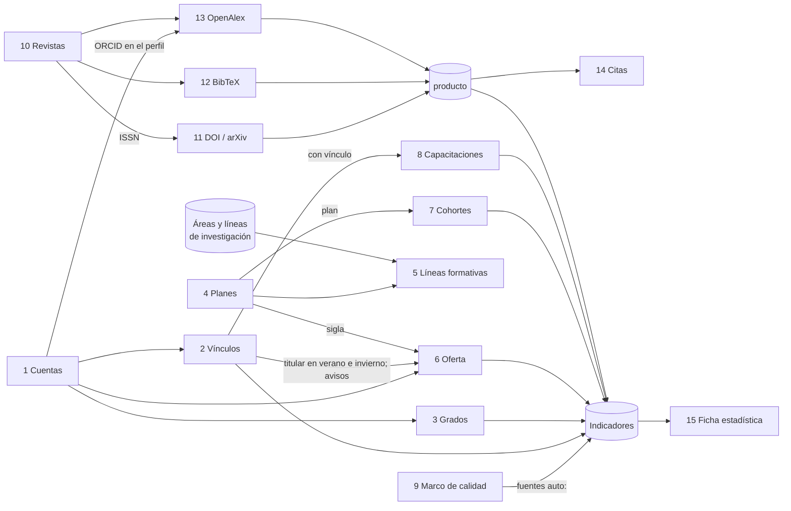

# Procesos de importación de datos de TAU

Informe del 9-nov-2026, al día al 15-nov-2026 (cargas 17 a 20). Reúne todas las vías por las que entran datos en bloque al sistema: archivos que sube el
personal, consultas a servicios bibliográficos externos y cargas iniciales que hacen las migraciones. Para cada una se
indica qué hace, qué campos lee, dónde guarda y con qué clave se une a lo que ya existe. Al final hay un mapa de
dependencias y el orden de carga recomendado.

No se cuentan como importación las exportaciones (BibTeX, XLSX del marco, CSV de encuestas, anexos), los formularios de
un solo registro ni el seed de ejemplo (`scripts/seed.py`).

## 1. Resumen

| # | Proceso | Origen | Quién (acción) | Pantalla o ruta | Modo | Tablas destino |
|---|---|---|---|---|---|---|
| 1 | Cuentas | CSV | Administración del sistema (`administrar_cuentas`) | `/admin/usuarios/importar` | Agrega (omite las que existen) | `usuario`, `investigador`, `vinculo` |
| 2 | Historial de vínculos | CSV de RR. HH. | Dirección de Carrera (`gestionar_vinculos`) | `/admin/usuarios/historial` | **Reemplaza** el historial de cada persona del archivo | `vinculo` |
| 3 | Grados académicos | CSV | Direcciones, Gestión de datos (`gestionar_fichas`) | `/admin/usuarios/importar-grados` | Agrega (omite repetidos) | `grado_academico` |
| 4 | Planes de estudio | CSV en `datos/planes/` | Migración 0028 | (sin pantalla) | Crea los planes que faltan | `programa`, `plan_estudios`, `asignatura`, `plan_asignatura`, `requisito`, `observacion_plan` |
| 5 | Líneas formativas | CSV en `datos/planes/` | Migración 0063 | (sin pantalla) | Actualiza | `asignatura` |
| 6 | Oferta de gestiones pasadas | CSV | Dirección de Carrera, Coordinación (`gestionar_oferta`) | `/docencia/oferta/importar` | **Reemplaza** la oferta de cada gestión del archivo | `gestion_academica`, `oferta`, `oferta_docente` |
| 7 | Cohortes de estudiantes | CSV de Seguimiento Académico | Dirección de Carrera, Gestión de datos (`gestionar_cohortes`) | `/docencia/cohortes/importar` | Crea o actualiza (por RU) | `persona_externa`, `estudiante` |
| 8 | Capacitaciones | CSV | Dirección de Carrera, Gestión de datos (`registrar_capacitacion`) | `/calidad/capacitacion/importar` | Agrega (omite repetidas) | `capacitacion` |
| 9 | Marco de calidad | CSV en `datos/calidad/marco-carrera/` | Migración 0051 | (sin pantalla) | Crea la versión si no existe | `marco_calidad`, `nivel_escala`, `atributo_calidad`, `dimension_calidad`, `criterio_calidad`, `indicador_calidad`, `indicador_atributo` |
| 10 | Catálogo de revistas | CSV | Dirección del Instituto (`gestionar_catalogos`) | `/admin/revistas/importar` | Crea o completa (sin borrar) | `revista`, `revista_indice` |
| 11 | Producto por DOI o arXiv | Crossref, arXiv, zbMATH Open | Cada investigador | `/productos/importar` | Prellena el formulario; guarda el investigador | `producto`, `producto_autor`, `producto_msc`, `persona_externa`, `revista` |
| 12 | BibTeX | Archivo `.bib` | Cada investigador | `/productos/importar-bibtex` | Crea las entradas elegidas | `producto`, `producto_autor`, `persona_externa` |
| 13 | Producción desde OpenAlex | OpenAlex (por ORCID) | Cada investigador | `/productos/openalex` | Crea las obras elegidas | `producto`, `producto_autor`, `persona_externa`, `revista`, `cosecha_descartada` |
| 14 | Citas desde OpenAlex | OpenAlex (por DOI) | Dirección del Instituto (`actualizar_citas`) | `/informes/citas/actualizar` | Actualiza | `producto` (`citas`, `openalex_id`) |
| 15 | Correspondencia de la ficha estadística | XLSX ajeno + CSV | Quien ve el marco (`ver_marco_calidad`) | `/calidad/ficha/plantilla` | No guarda: devuelve el XLSX lleno | (ninguna) |
| 16 | Paquete completo | `.tar.gz` | TI, por consola, con el sistema detenido | `scripts/paquete.py importar` | Reemplaza toda la instalación | Toda la base, fotos, adjuntos y evidencias |
| 17 | Plan de mejora | CSV (`datos/calidad/plan-de-mejora-2026-2030.csv`) | Dirección de Carrera (`gestionar_plan_mejora`) | `/calidad/mejora/importar` | Agrega las acciones cuyo código no existe | `accion_mejora`, `actividad_mejora` |
| 18 | Rendimiento por asignatura | CSV agregado de Seguimiento Académico | Dirección de Carrera, Gestión de datos (`gestionar_cohortes`) | `/docencia/cohortes/rendimiento/importar` | Crea o **reemplaza** por asignatura y gestión | `rendimiento_asignatura` |
| 19 | Lista de curso | CSV de Kardex | Dirección de Carrera, Coordinación (`gestionar_oferta`) | `/docencia/listas` | **Reemplaza** la copia de cada paralelo del archivo; se borra al concluir la gestión | `lista_curso` |
| 20 | Malla de un plan en elaboración | CSV (mismo formato que `datos/planes/`) | Dirección de Carrera, Coordinación (`elaborar_planes`) | `/docencia/planes/{id}/malla/importar` | **Reemplaza** la malla del plan | `plan_asignatura`, `asignatura`, `requisito` |

Las vacantes de admisión (`/docencia/cohortes/vacantes`) se registran a mano, una por admisión, y no son una carga: los
admitidos salen de las cohortes (proceso 7).

## 2. Lo que comparten las cargas CSV

Las cargas por pantalla (1–3, 6–8, 10 y 17–19) siguen el mismo patrón, definido en `app/comun/importar_usuarios.py`
(`leer_tabla`); la lista de curso (19) se aplica en un solo paso y la malla (20) usa el lector de los planes:

- **Dos pasos.** `leer(contenido)` valida y clasifica sin escribir nada, y la pantalla muestra la vista previa con
  errores por fila. Después `aplicar` (o `crear`) guarda solo lo que no tiene errores. Entre los dos pasos el archivo
  viaja de nuevo en el formulario, así que la base no guarda nada intermedio.
- **Lectura tolerante.** Acepta UTF-8 (con o sin BOM) o Latin-1. Detecta solo el separador (coma, punto y coma o
  tabulador). Reconoce los encabezados por alias, sin tildes ni mayúsculas: «Correo», «E-mail» y «correo institucional»
  valen como `email`. Las filas vacías se omiten.
- **Fechas:** `AAAA-MM-DD` o `DD/MM/AAAA`. **Sí/no:** sí, s, x, 1, true, verdadero, yes; no, n, 0, false, falso.
- **Límites:** 1 MB por archivo (BibTeX, 2 MB) y un máximo de filas que depende de la carga (de 500 a 20 000).
- **Plantilla descargable** con datos ficticios en cada pantalla (`…/plantilla`).
- **Auditoría:** cada carga deja un registro con el número de filas (`importar_usuarios`, `importar_vinculos`,
  `importar_oferta`, `importar_cohortes`, `importar_capacitacion`, `importar_revistas`, `cargar_openalex`,
  `cargar_plan_mejora`, `cargar_rendimiento`, `cargar_listas`, `importar_malla_plan`). Los grados se auditan uno por uno
  (`agregar_grado`).

Las cargas que hacen las migraciones (4, 5 y 9) usan solo la conexión que reciben (`execute`/`fetchall`), porque
fastmigrate las corre en un proceso aparte, sin la aplicación.

## 3. Detalle de cada proceso

### 3.1 Cuentas (`app/comun/importar_usuarios.py`)

Da de alta en bloque al personal. Opcionalmente, envía a cada persona un enlace de invitación; si no, la pantalla
muestra una contraseña temporal por cuenta para entregarla a mano.

| Campo | Oblig. | Valores | Destino |
|---|---|---|---|
| `email` | sí | correo válido, único en el archivo | `usuario.email` (en minúsculas) |
| `nombres`, `apellidos` | sí | texto | `usuario.nombres`, `usuario.apellidos` |
| `categoria` | no | titular, contratado, interino, invitado, externo (también en femenino) | primer `vinculo.categoria` |
| `fecha_ingreso` | no | fecha | primer `vinculo.fecha_inicio` |
| `investigador` | no (sí) | sí/no | crea la fila de `investigador` |
| `admin` | no (no) | sí/no | rol de administración |

- **Clave:** `email`. Si ya hay una cuenta con ese correo, la fila se omite («existe»).
- **Reglas:** solo un investigador puede traer categoría. Si se omite la categoría, se asigna después desde el listado.
- **Límite:** 500 filas.

### 3.2 Historial de vínculos (`app/comun/importar_vinculos.py`)

Carga los periodos de vínculo que entrega Recursos Humanos, la fuente oficial. Para cada persona del archivo, su
historial **se reemplaza** entero; las personas que no aparecen no cambian.

| Campo | Oblig. | Valores | Destino (`vinculo`) |
|---|---|---|---|
| `email` | sí | correo de una persona registrada | `usuario_id` |
| `categoria` | sí | como en 3.1 | `categoria` |
| `desde` | sí | fecha | `fecha_inicio` |
| `hasta` | según categoría | fecha; vacía = vigente | `fecha_fin` |
| `jornada` | no | 1–60 h semanales | `jornada_horas` |
| `nota` | no | texto (resolución, contrato) | `nota` |
| `carga` | no | 32–160 h/mes, múltiplo de 32 | `horas_contratadas` |
| `docencia`, `investigacion`, `extension`, `gestion`, `otras` | no | múltiplos de 32 que suman `carga` | `carga_docencia`… `carga_otras` |

- **Clave:** `email`, que debe pertenecer a una persona registrada (proceso 1).
- **Reglas:**
  - Contratados, interinos e invitados necesitan fecha de término.
  - Los periodos de una persona no pueden superponerse, y solo el último puede quedar sin término.
  - Si el archivo trae una columna `unidad`, se ignora: el vínculo siempre es con la Carrera.
- **Efectos:** al cambiar los vínculos se revisan las cargas en proyectos (`vinculos.OYENTES`) y se recalculan el cargo y
  la unidad del perfil (`adscripcion.py`).
- **Límite:** 2000 filas.

### 3.3 Grados académicos (`app/comun/importar_grados.py`)

Completa las fichas académicas que se usan en el cuerpo académico y en los indicadores de calidad.

| Campo | Oblig. | Valores | Destino (`grado_academico`) |
|---|---|---|---|
| `email` | sí | persona registrada | `usuario_id` |
| `nivel` | sí | licenciatura, maestría, doctorado, especialidad, técnico, otro; también «Lic.», «M.Sc.», «Ph.D.», «Dr.»… | `nivel` |
| `titulo`, `institucion`, `pais` | no | texto | ídem |
| `anio` | no | año | `anio` |

- **Clave:** `email`. Un grado ya registrado (mismo nivel e institución, o mismo nivel y título) se omite, así que
  volver a subir el archivo no duplica nada.
- **Límite:** 2000 filas.

### 3.4 Planes de estudio (`app/academico/importar_planes.py`, migración 0028)

Carga los planes 2017, transcritos de los PDF oficiales, sin corregir nada. Lo que no cuadra queda registrado en
`observacion_plan` para que la Dirección Académica lo revise. El formato está en `datos/planes/README.md`. Un plan
nuevo ya no necesita una migración: se crea en pantalla dentro de una reforma curricular y su malla se arma a mano o
con el mismo CSV (proceso 20).

**`planes.csv`** (un plan por fila) → `programa` y `plan_estudios`:
- `archivo`, `programa`, `nivel`, `plan`, `resolucion` y `vigente_desde`.
- `sistema` (horas o créditos), `semanas_semestre`, `horas_por_credito` y `nota_minima`.
- Los totales declarados: `total_teoricas`, `total_practicas`, `total_laboratorio` y `total_creditos`.

**Un CSV por plan** (una fila por asignatura o casilla de electiva) → `asignatura`, `plan_asignatura` y `requisito`:
- `sigla`, `nombre`, `tipo`, `semestre` y `ciclo`.
- `horas_teoricas`, `horas_practicas`, `horas_laboratorio` o `creditos`.
- `requisitos`: siglas separadas por «;», o `egresado`.

**`observaciones.csv`** (`archivo`, `sigla`, `detalle`) → `observacion_plan`, con tipo `documento`.

- **Claves:**
  - El programa se reconoce por su nombre; el plan, por programa y nombre (si ya existe, no se carga).
  - La asignatura se reconoce por su `sigla`, y el catálogo de asignaturas lo comparten todos los planes. La primera
    vez que aparece una sigla se crea la asignatura, con `de_la_carrera = 1` si empieza por `MAT`.
  - Los requisitos se guardan como sigla, sin clave foránea, para poder cargar uno que no existe y marcarlo.
- **Inconsistencias que se detectan solas:** nombres distintos para una sigla, asignaturas repetidas en un plan,
  requisitos que no figuran en el plan y totales distintos de los declarados.

### 3.5 Líneas formativas (`importar_planes.cargar_lineas_formativas`, migración 0063)

**`lineas-formativas.csv`**: `sigla`, `linea_formativa`, `area`, `linea` → `asignatura.linea_formativa`, `area_id` y
`linea_id`. El área y la línea de investigación se buscan por nombre, sin distinguir mayúsculas. Si falta el área, se
toma la de la línea. Lo que no se encuentra queda vacío.

### 3.6 Oferta de gestiones pasadas (`app/academico/importar_oferta.py`)

Carga la oferta histórica: los paralelos y sus docentes. Con ella se calcula la carga docente de semestres pasados.

| Campo | Oblig. | Valores | Destino |
|---|---|---|---|
| `gestion` | sí | I-2021, INV-2021, II-2021, VER-2021 | `gestion_academica` (se crea el año si falta) |
| `sigla` | sí | asignatura del catálogo y de la Carrera | `oferta.asignatura_id` |
| `paralelo` | no (A) | hasta 3 caracteres alfanuméricos | `oferta.paralelo` |
| `inscritos` | no | entero, el mismo en todas las filas del paralelo | `oferta.inscritos` |
| `email` | no | persona registrada; vacío = sin docente | `oferta_docente.usuario_id` |
| `rol` | no (titular) | titular o auxiliar | `oferta_docente.rol` |

- **Formato:** una fila por docente de cada paralelo.
- **Claves:**
  - La gestión, por su código.
  - La asignatura, por `sigla` (proceso 4).
  - El docente, por `email` (proceso 1).
- **Reglas:**
  - La oferta de cada gestión del archivo se **reemplaza** entera, así que reimportar no duplica nada.
  - Es todo o nada por gestión: un error en una fila deja esa gestión sin importar.
  - En verano e invierno, un titular debe tener vínculo de titular (proceso 2) en la fecha de inicio de la gestión.
  - Un docente sin vínculo con la Carrera en esa gestión genera un aviso, pero la fila se importa igual.
- **Límite:** 5000 filas.

### 3.7 Cohortes de estudiantes (`app/estudiantil/importar.py`)

Carga el CSV que entrega Seguimiento Académico: una fila por estudiante de licenciatura, sin materias ni notas.

| Campo | Oblig. | Valores | Destino (`estudiante`, salvo que se indique) |
|---|---|---|---|
| `ru` | sí | 3–20 caracteres | `registro_universitario` |
| `nombres`, `apellidos` | sí | texto | `persona_externa` |
| `cohorte` | sí | AAAA-I o AAAA-II, no futura | `cohorte_anio`, `cohorte_ciclo`, `desde` |
| `estado` | sí | cursando, egresado, titulado, retirado, congelado (con sinónimos) | `estado` |
| `email` | no | correo | `persona_externa.email` (solo si estaba vacío) |
| `sexo` | no | hombre/mujer (M/F…) | `sexo` |
| `fecha_nacimiento` | no | fecha; **no se guarda** | `edad_ingreso` (calculada, 14–80) |
| `via` | no | ordinaria o especial | `via_ingreso` |
| `otra_ciudad`, `extranjero` | no | sí/no | ídem |
| `colegio` | no | público o privado (fiscal, particular…) | `colegio` |
| `plan` | no | «Plan 2017» o «Programa · Plan», entre los planes de licenciatura | `plan_id` |
| `ultimo_ciclo` | si retirado o congelado | AAAA-I o AAAA-II | `ultimo_anio`, `ultimo_ciclo` |
| `fecha_egreso` | si egresado o titulado | fecha | `fecha_egreso` |
| `fecha_titulacion` | si titulado | fecha | `fecha_titulacion`, `titulado = 1` |
| `modalidad` | no | tesis, proyecto de grado, trabajo dirigido, examen de grado, excelencia, otra | `modalidad_titulacion` |
| `motivo` | si retirado | académico o no académico | `motivo_retiro` |

- **Claves:**
  1. Se busca el `ru` en `estudiante.registro_universitario`; si está, se actualiza ese periodo.
  2. Si no, se busca a la persona en `persona_externa`, por correo o por nombre parecido, siempre que no tenga ya otro
     RU.
  3. Si tampoco, se crea la persona.
- **Plan de estudios:** se busca solo entre los planes de licenciatura. Con el nombre solo («Plan 2017») se toma el
  del programa en que la carga registra a los estudiantes (Licenciatura en Matemática). Con el programa delante
  («Licenciatura en Matemática Aplicada · Plan 2017»), el de ese programa. Un nombre que tienen varios programas y no
  el programa por omisión es un error: no se adivina.
- **Unión con otros módulos:** la cuenta de estudiante se une a esta ficha por `cuenta_estudiante`. El egresado se
  deduce de `estado = titulado` más la fecha de titulación, y de ahí salen las encuestas de seguimiento (PLAN §50).
- **Límite:** 2000 filas.

### 3.8 Capacitaciones (`app/calidad/importar_capacitacion.py`)

Carga la formación continua del cuerpo académico, que alimenta los indicadores de calidad.

| Campo | Oblig. | Valores | Destino (`capacitacion`) |
|---|---|---|---|
| `email` | sí | persona con vínculo con la Carrera | `usuario_id` |
| `titulo` | sí | texto | `titulo` |
| `area` | sí | disciplinar, pedagógica, investigación, gestión, ia_digital, otra (o su nombre) | `area` |
| `institucion`, `horas` | no | texto, entero | ídem |
| `fecha_inicio`, `fecha_fin` | no | fecha (si falta una, se copia la otra) | ídem |
| `anio` | no | año, si no hay fechas: se registra el 31-dic, o hoy si es el año en curso | `fecha_inicio`, `fecha_fin` |

- **Clave:** `email`, con vínculo (proceso 2). Una capacitación con la misma persona, el mismo nombre y la misma fecha de
  término se omite.
- **Límite:** 2000 filas.

### 3.9 Marco de calidad (`app/calidad/marco_csv.py`, migración 0051)

Carga una vez el borrador del marco del SIAC. Después se edita en la pantalla, que lo exporta a XLSX con las mismas
columnas (`COLUMNAS`), para poder volver a cargarlo.

| Archivo | Campos | Destino |
|---|---|---|
| `marco.csv` | `campo` / `valor` (nombre, version, descripcion, vigente_desde, ventana_anios) | `marco_calidad` |
| `escala.csv` | `valor`, `nombre`, `descripcion` | `nivel_escala` |
| `atributos.csv` | `clave`, `nombre`, `descripcion` | `atributo_calidad` |
| `dimensiones.csv` | `codigo`, `nombre`, `descripcion`, `referencia` | `dimension_calidad` |
| `criterios.csv` | `dimension`, `codigo`, `nombre`, `descripcion` | `criterio_calidad` |
| `indicadores.csv` | `criterio`, `codigo`, `nombre`, `tipo`, `formula`, `fuente`, `unidad_medida`, `frecuencia`, `sentido`, `responsable`, `referencia`, `atributos` | `indicador_calidad`, `indicador_atributo` |

- **Claves internas por código:**
  - criterio → dimensión (`dimension`);
  - indicador → criterio (`criterio`);
  - indicador → atributos (`atributos`, claves separadas por «|»).
  Un código desconocido detiene la carga.
- **Unidad y versión:** el marco es de la unidad `CMAT`; si esa versión ya existe, no se hace nada.
- **Fuente de cada indicador:** `manual` o `auto:<clave>`. Las claves automáticas (`FUENTES_AUTOMATICAS`) calculan la
  cifra con los datos de los procesos 2, 3, 6, 7, 8 y 11–13.

### 3.10 Catálogo de revistas (`app/investigacion/importar_revistas.py`)

Carga las revistas donde publica el Instituto, con sus indexaciones. Lo que carga la administración queda verificado.

| Campo | Oblig. | Destino |
|---|---|---|
| `titulo` | sí | `revista.titulo` |
| `issn`, `eissn` | no | `revista.issn`, `revista.eissn` |
| `pais`, `editorial` | no | ídem |
| `arbitrada`, `acceso_abierto` | no (sí/no) | ídem |
| `indice` | no | `revista_indice.indice_id` (por nombre: «Scopus», «WoS ESCI», «zbMATH»…) |
| `desde`, `hasta`, `cuartil`, `fuente`, `evidencia` | no | `revista_indice.*` |

- **Formato:** una fila por revista e índice. Las filas de una misma revista se agrupan por ISSN o eISSN y, si no
  tienen, por título.
- **Clave:** se busca primero el ISSN, después el eISSN y por último el título sin tildes. Una revista que ya existe se
  completa, sin borrar sus datos, y se le agregan las indexaciones nuevas.
- **Efecto:** después de cargar se reclasifican los artículos de esas revistas (`revistas.reclasificar`), porque la
  clasificación del artículo (indexado o arbitrado) sale del catálogo.
- **Límite:** 3000 filas.

### 3.11 Producto por DOI o arXiv (`app/investigacion/importacion.py`)

Por cada identificador que pega el investigador, el sistema consulta **Crossref** (DOI) o **arXiv**, y prellena el
formulario del producto. No se guarda nada hasta que la persona confirma. Los DOI `10.48550/arXiv.*` se tratan como
arXiv.

| Dato de la fuente | Campo del producto |
|---|---|
| `type` (Crossref) / siempre «Preprint» (arXiv) | `tipo_id` (`TIPOS_CROSSREF`) |
| título, año y mes de publicación | `titulo`, `anio`, `mes` |
| revista o editorial / categoría primaria de arXiv | `medio` |
| volumen, número, páginas, resumen (sin JATS ni MathML) | `volumen`, `numero`, `paginas`, `resumen` |
| DOI / identificador arXiv | `doi` / `arxiv_id` |
| ISSN impreso y electrónico | `revista_id`, o una revista nueva propuesta (pendiente) |
| autores: nombre, ORCID, afiliación | `producto_autor` (ver abajo) |
| MSC2020 de **zbMATH Open** (solo si hay DOI) | sugerencia para `producto_msc` |

- **Estado y revisión:** todo entra como «publicado». Lo de Crossref entra como «arbitrado» y los preprints, «sin
  arbitraje».
- **Duplicados:** un DOI o un arXiv ya registrado se avisa en lugar de prellenar. Al importar la versión publicada de un
  preprint se crea un registro aparte, enlazado por `publicado_como_id`.
- **Autores** (`resolver_autores`, que también usan los procesos 12 y 13):
  1. Investigador del sistema (`i:<id>`): se reconoce por ORCID o, si hay una sola coincidencia, por el apellido y la
     inicial.
  2. Externo ya registrado (`e:<id>`): se reconoce por un nombre parecido, y se le completa el país.
  3. Si no, queda una referencia provisional (`n:`), que se registra como `persona_externa` al guardar.
- **Filiación:** se marca «Firmó» (`filiacion_instituto`) si la afiliación publicada menciona IIMAT, CMAT, FCPN o UMSA.
  El país del coautor se deduce de la afiliación.

### 3.12 BibTeX (`app/investigacion/bibtex.py`)

Lee un `.bib`: convierte los acentos LaTeX y conserva las fórmulas `$…$`. Clasifica cada entrada como nueva, duplicada o
error, y el investigador elige cuáles crear.

| BibTeX | Producto |
|---|---|
| tipo de entrada (`@article`, `@inproceedings`, `@book`, `@incollection`, `@techreport`, `@unpublished`, `@software`; `@misc` solo si es arXiv) | `tipo_id` (`TIPOS`); otro tipo da error |
| `title`, `year`, `month` | `titulo`, `anio`, `mes` |
| `journal` / `booktitle` / `publisher` / `institution` / `school` / `howpublished` | `medio` |
| `volume`, `number` o `issue`, `pages`, `doi`, `url`, `abstract` | ídem |
| `eprint` + `archivePrefix`, `arxiv`, o una URL o un `journal` que mencione arXiv | `arxiv_id` |
| `pubstate` / `note` («accepted», «in press», «submitted»…) | `estado_publicacion` |
| `issn` + medio | `revista_id` (solo si ya está en el catálogo; no crea revistas) |
| `author` (o `editor`) | `producto_autor` (como en 3.11, sin ORCID ni afiliación) |

- **Duplicados:** una entrada cuenta como duplicada si coincide el DOI, el arXiv, o el título normalizado y el año.
- **Límites:** 2 MB y 300 entradas.
- **Sin MSC:** esta vía no consulta zbMATH.

### 3.13 Producción desde OpenAlex (`app/investigacion/openalex.py`, `cosecha.py`)

Busca en OpenAlex las obras del investigador por el **ORCID de su perfil** (`investigador.orcid`), con un máximo de 200
y en un rango de años (por omisión, los últimos 5). Cada obra queda clasificada:
- **nueva**;
- **registrada** (coincide el `openalex_id`, el DOI, el arXiv o el título y el año);
- **descartada** (la persona la descartó antes: `cosecha_descartada`);
- **no se importa** (tesis, datos, erratas y otros tipos sin equivalente).

| OpenAlex | Producto |
|---|---|
| `type` + tipo de la fuente | `tipo_id` (`tipo_portal`) |
| `title`, `publication_year`, `publication_date` (el 1 de enero cuenta como mes desconocido) | `titulo`, `anio`, `mes` |
| `primary_location.source.display_name` | `medio` |
| `biblio` (volumen, número, páginas) | ídem |
| `doi`; URL de arXiv en `locations` | `doi`, `arxiv_id` |
| `abstract_inverted_index` (se reconstruye) | `resumen` |
| ISSN de la fuente | `revista_id`; si la revista no está, se propone como pendiente |
| `authorships` (nombre, ORCID, afiliaciones, país) | `producto_autor`, `persona_externa.pais` |
| `id`, `cited_by_count` | `openalex_id`, `citas`, `citas_actualizadas` |

- **Autoría:** el investigador se reconoce siempre por su ORCID. Si no aparece entre los autores, la obra no se
  registra.
- **Sin MSC:** esta vía tampoco consulta zbMATH.

### 3.14 Citas desde OpenAlex (`cosecha.actualizar_citas`)

Consulta OpenAlex en lotes de 50 DOI y actualiza `producto.citas` y `citas_actualizadas` de cada producto con DOI.
Fija `openalex_id` solo si estaba vacío y ningún otro producto lo usa.

### 3.15 Correspondencia de la ficha estadística (`app/calidad/ficha.py`)

Recibe dos archivos: un XLSX ajeno (la plantilla de una agencia) y un CSV de correspondencia con las columnas `hoja`,
`celda` y `clave` (p. ej., `academicos.total.2025`). Devuelve el XLSX con esas celdas llenas con cifras del sistema.
Escribe solo esas celdas (`xlsx_plantilla.py`), para no borrar gráficos ni imágenes. **No guarda nada** en la base. La
correspondencia es privada y no se versiona (PLAN §57).

### 3.16 Paquete completo (`scripts/paquete.py importar`)

Restaura la base SQLite, las fotos, los adjuntos y los archivos de las evidencias desde un `.tar.gz` exportado por el
mismo script, para mudar el sistema o restaurar un respaldo.
- Se ejecuta con el sistema detenido.
- Si ya hay datos, exige `--reemplazar` y antes los mueve a `respaldo-previo-<fecha>`.
- Si el paquete es de un esquema anterior, aplica las migraciones pendientes. Compara solo los conteos que trae el
  manifiesto. Un paquete anterior al 15-nov-2026 no trae la carpeta `evidencias/`: esos archivos se copian aparte.

### 3.17 Plan de mejora (`app/calidad/importar_mejora.py`)

Una fila por actividad, con las columnas de su acción repetidas: `accion`, `accion_titulo`, `objetivo`,
`accion_responsable`, `prioridad`, `criterio`, `actividad`, `descripcion`, `responsable`, `presupuesto`, `fuente`,
`recursos_humanos`, `otros_recursos`, `verificacion`, `indicador`, `linea_base`, `meta`, `difusion`, `inicio` y `fin`
(obligatorias: `accion`, `accion_titulo`, `descripcion` y `fin`).
- **Responsables:** el archivo trae unidades en texto. La vista previa **propone** a la persona que hoy ocupa ese cargo
  (Dirección de Carrera, Dirección del Instituto, Coordinación académica, Comisión de calidad) y, si no la encuentra,
  deja la acción a cargo de quien carga el archivo.
- **Indicadores:** una actividad cuyo indicador ya calcula el sistema se propone ligada a él («Ligar al indicador…»).
  La cifra del archivo queda como línea base en texto.
- **Repetidos:** se omite toda acción cuyo código ya está en el plan; cargar dos veces el mismo archivo no duplica nada.
  Hasta 500 filas.

### 3.18 Rendimiento por asignatura (`app/estudiantil/rendimiento.py`)

Agregados del Sistema de Seguimiento Académico: `sigla`, `gestion` (`I-2025`, `2025-I` o `II/2025`), `inscritos`,
`aprobados`, `reprobados` y `abandonos`. **Sin RU, nombres ni notas.**
- La sigla debe estar en el catálogo de asignaturas. Aprobados, reprobados y abandonos no pueden sumar más que los
  inscritos.
- Una asignatura y gestión que ya existe se **reemplaza**.
- Una asignatura con menos de 5 inscritos se muestra como «menos de 5» y no entra en los totales, para que no se
  deduzca por resta. Hasta 3000 filas.

### 3.19 Lista de curso (`app/academico/listas.py`)

CSV de Kardex con `sigla`, `paralelo`, `ru`, `apellidos`, `nombres` y `correo`, para una gestión que no haya concluido.
- Reemplaza la copia de cada paralelo que trae. Los paralelos que no están en la oferta se informan y se omiten.
- Es una **copia temporal**: se borra al concluir la gestión (`listas.purgar`). La ven solo los docentes de ese
  paralelo, y cada consulta se audita.
- Con `TAU_LISTAS_URL` no hay carga: la lista se consulta a la API de Kardex en el momento y no se guarda.
- Hasta 20 000 filas.

### 3.20 Malla de un plan en elaboración (`app/academico/malla.py`)

El mismo CSV por plan de §3.4, con plantilla descargable. Solo para un plan **en elaboración**, cuya malla reemplaza
entera. Después, la lista de verificación del plan señala requisitos circulares o que faltan.

## 4. Cómo se vinculan

### 4.1 Claves de unión

| Clave | Identifica | La usan |
|---|---|---|
| `email` | persona del personal (`usuario`) | 1 (la crea); 2, 3, 6 y 8 (la exigen) |
| `registro_universitario` (RU) | periodo de estudios (`estudiante`) | 7 |
| nombre y apellidos (parecido) | `persona_externa` | 7 (estudiantes); 11–13 (coautores externos) |
| ORCID | investigador | 11 y 12 (reconocer autores); 13 (buscar la producción) |
| `sigla` | `asignatura` | 4 (la crea); 5 y 6 (la exigen) |
| código de gestión (`I-2021`) | `gestion_academica` | 6 |
| nombre del plan, o programa y plan | `plan_estudios` (de licenciatura) | 7 |
| nombre de área y de línea | `area_investigacion`, `linea_investigacion` | 5 |
| ISSN, eISSN o título | `revista` | 10 (la crea o completa); 11 y 13 (la reconocen o proponen); 12 (solo la reconoce) |
| DOI, arXiv, `openalex_id` o título + año | `producto` (duplicados) | 11–14 |
| nombre del índice | `indice` | 10 |
| códigos del marco | dimensión, criterio, indicador, atributo | 9 |

### 4.2 Mapa de dependencias

### 4.3 Orden de carga recomendado en una instalación nueva

Las migraciones ya cargan los planes, las líneas formativas y el marco (procesos 4, 5 y 9). Después:

1. **Cuentas** (1): sin ellas fallan los procesos 2, 3, 6 y 8.
2. **Historial de vínculos** (2): define quién es titular y quién tiene vínculo, que es lo que revisan los procesos 6 y 8.
3. **Grados** (3) y **capacitaciones** (8), en cualquier orden.
4. **Oferta pasada** (6): necesita las cuentas, los vínculos y el catálogo de asignaturas.
5. **Cohortes** (7): necesitan los planes. Conviene cargarlas antes de crear cuentas de estudiante y encuestas de
   egresados.
6. **Revistas** (10), antes de que los investigadores importen productos, para que sus artículos se reconozcan como
   verificados.
7. **Producción** (11–13), que carga cada investigador; después, **citas** (14).
8. **Plan de mejora** (17), después de asignar los roles de las direcciones, la Coordinación y la Comisión: con ellos
   la vista previa propone a cada responsable.
9. **Rendimiento** (18), después de los planes; la **lista de curso** (19), cuando la gestión ya tiene su oferta.

## 5. Diferencias de comportamiento entre las cargas

| Aspecto | Cuentas | Vínculos | Grados | Oferta | Cohortes | Capacitaciones | Revistas |
|---|---|---|---|---|---|---|---|
| Lo existente | se omite | se reemplaza | se omite | se reemplaza | se actualiza | se omite | se completa |
| Unidad de rechazo | fila | persona | persona | gestión | fila | fila | revista |
| Filas máx. | 500 | 2000 | 2000 | 5000 | 2000 | 2000 | 3000 |

## 6. Hallazgos al revisar el código

1. **Corregido (PLAN §63, etapa 2): la carga de cohortes asignaba mal el plan de estudios.** Armaba el diccionario
   de planes por nombre, y los cuatro planes vigentes se llaman «Plan 2017»: el último pisaba a los demás. Un
   estudiante de licenciatura con `plan = Plan 2017` quedaba, sin ningún aviso, con el plan de la Maestría en
   Matemática Aplicada. Ahora el plan se busca solo entre los de licenciatura, como describe §3.7. Si una instalación
   ya cargó cohortes con la columna `plan`, basta volver a subir el mismo archivo: la carga actualiza por RU.
2. **Cuentas, filas de más:** al pasar las 500 filas devuelve las filas leídas *y* un error. Las demás cargas no
   devuelven nada en ese caso. Es inofensivo, porque la pantalla muestra el error, pero es una inconsistencia.
3. **Revistas, conteo de filas:** cuenta líneas del archivo en vez de filas con datos, así que las líneas vacías
   intermedias acercan el límite. Es menor.
4. **Sin pantalla para el marco:** una versión nueva del marco requiere editar los CSV y escribir una migración. Los
   planes ya tienen la suya desde el 12-nov-2026 (PLAN §65; proceso 20).
5. **MSC solo por DOI:** los productos que entran por BibTeX u OpenAlex quedan sin clasificación MSC. Es una decisión
   documentada (PLAN §45); se puede compensar con la sugerencia por área del perfil.
